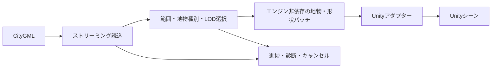

# Universal 3D Data Engine 開発計画

> **プロジェクト状態:** 計画中
> **文書バージョン:** 0.3
> **最終更新:** 2026-11-23
> **作業名:** `universal-3d-engine`

## 1. この文書の目的

本書は、CityGML形式の都市モデルデータをゲームエンジンへ取り込む、独立した実装の開発計画である。読み込み速度、取り込み粒度、複数エンジンでの再利用を重視する。

初期の対象範囲を絞り、代表データで性能と粒度を検証できる小さな縦切りから始める。初期実装と終了条件はADR（Architecture Decision Record）に記録する。

### 1.1 設計上の前提

- 最初の利用先はUnityとし、CityGML都市モデルの選択した範囲・地物をUnityシーンへ段階的に取り込む。
- 入力形式の読み込みとエンジンへのデータ提供が主目的であり、任意の形式変換ツールは作らない。MVPの「出力」はUnity上のシーン・メッシュ・属性として利用可能にすることを指し、別形式ファイルへの書き出しは含めない。
- 共通データ処理とエンジン固有アダプターを分離する。GodotとUnreal Engineへの対応は将来目標だが、Unityでの縦切りと技術検証を終えてから個別に追加する。
- 独立した実装とし、上流リポジトリのIssue対応やフォークを前提にしない。既存コードを再利用する場合はライセンスと著作権表示を維持する。

## 2. 製品の目的と範囲

### 2.1 長期的な目的

CityGML形式の都市モデルを、必要な範囲と粒度でゲームエンジンへ取り込むための共通データ処理基盤を作る。元データの地物ID、属性、LOD、座標参照情報を可能な範囲で保持し、Unity、Godot、Unreal Engineの各アダプターから利用できる構成を目指す。

### 2.2 初期リリースの利用者と価値

初期の対象は、CityGML形式の都市モデルをゲームエンジンで利用したい開発者とする。MVPではUnity向けに次の作業を可能にする。

1. 利用者がローカルの都市モデルデータと対象範囲を指定する。
2. 地物種別やLODを絞り、データ全体を一度に読み込まずに選択した地物を順次取り込む。
3. 取り込み中の進捗を確認し、処理をキャンセルできる。
4. 生成したUnityシーン上のメッシュから、元地物のIDや対応属性を参照できる。

対象データ全体を一括ロードすることや、CityGMLから汎用3Dファイルへの変換はMVPの目的ではない。CIでは対応OS上でUnityパッケージをビルドし、少なくとも一つのEditModeまたは単体テスト経路を通す。CityGMLフィクスチャの取り込み結果も自動検証する。

### 2.3 初期版で扱わないもの

- CityGMLの全バージョン・全拡張・全都市モデルデータを一度に完全対応すること。
- CityGMLからglTF、3D Tiles等への汎用ファイル変換・最適化パイプライン。
- Unity・Godot・Unreal Engineの同時リリース、全機能の完全同等性。
- CADのB-Rep編集、STEP/IFCの変換、点群、Gaussian Splatting。
- 初期からのオンライン配信、分散処理、GPU処理、独自データベース。
- 全入力情報の完全保持や、OS・エンジン間での完全同一出力。

将来候補は、具体的な利用要求、代表データ、保守コストを確認してから個別に採否を決める。

## 3. 実装方針

### 3.1 小さな縦切りを優先する

初期から全機能を一度に実装しない。CityGMLの小さな代表データをUnityへ取り込むまでを実装し、読み込み粒度・メモリ・応答性の改善を先に検証する。

将来エンジン間で共有する境界は設計するが、Unity・Godot・Unreal Engineの抽象化層を最初から過剰に作らない。

### 3.2 エンジン非依存コアと個別アダプター

- 最初のUnity実装はC#で行い、CityGML読込、地物選択、共通データ表現とUnityシーン生成の境界を明示する。
- コアの型や処理ロジックにUnityの`GameObject`、`Mesh`等を直接混在させない。Unity固有処理はUnityアダプターに置く。
- GodotとUnreal Engineでの再利用方式は、各エンジンの言語・ランタイム・配布要件を調査してADRで決める。特にUnreal EngineからC#コアを直接使えるとは仮定せず、最小の技術検証を行う。
- Unity Editorのバージョン、対応するホストOS、対象プラットフォームを固定し、CIと利用手順に記載する。
- CityGML読込ライブラリを採用する場合は、必要なCityGMLバージョン、ストリーミング性、メモリ使用量、ライセンス、対応OSを代表データで検証する。
- 独立した新規実装を基本とする。既存コードを再利用する場合は、MITライセンスを含む権利・著作権表示を保持する。
- 公開APIは実利用が進み、利用者の要求が確認できるまでは安定版と約束しない。

### 3.3 損失を隠さない

読み込みで扱えない地物、属性、LOD、CRSを黙って破棄しない。対応範囲を文書化し、未対応・不正データ・部分取り込みを利用者が判別できるようにする。

## 4. 初期アーキテクチャ



初期版の責務は次の範囲に限る。

| コンポーネント | 初期版の責務 |
|---|---|
| CityGMLリーダー | 選定したCityGMLデータの逐次読込と診断 |
| 選択・スケジューラー | 範囲、地物種別、LODに基づく要求と段階的な取り込み |
| 共通データ表現 | 地物ID、属性、座標情報、形状をエンジン非依存の単位で渡す |
| Unityアダプター | 受け取った地物バッチからUnityのMesh等を生成し、属性参照を提供 |
| 取り込み状態 | 進捗、キャンセル、警告、部分取り込み結果を利用者に伝える |

初期版では、汎用ファイル変換CLI、MCP、ネイティブ境界、独自キャッシュDBを作らない。

## 5. MVPの仕様

### 5.1 対応範囲

最初のスコープは、選定した一つのCityGML都市モデルデータセットをUnityへ取り込む機能とする。形式バージョン、データセット、必要な地物と属性をフェーズ0で確定する。

| 項目 | MVPでの扱い |
|---|---|
| 入力 | ローカルのCityGML都市モデルデータ。オンラインデータ取得は後続候補 |
| CityGMLバージョン | 選定データセットの実バージョンに限定して対応する |
| 選択粒度 | 少なくとも対象範囲と地物種別を指定でき、可能な範囲で個別地物を逐次処理する |
| LOD・属性 | 対象データに存在する必要LOD・地物ID・属性をADRで固定し、テストする |
| Unity上の表現 | 地物単位の意味情報を保持しつつ、描画用Meshのグルーピング粒度は別に扱う。地物ごとに必ずGameObjectを作る設計にはしない |
| 座標 | 選定データのCRSを明示し、Unityローカル座標への原点・精度方針を定める。未知のCRSを推測しない |
| 大容量処理 | XML DOM等でデータ全体を一括保持しない方式を優先し、時間・ピークメモリ・初回表示時間を測定する |
| 出力 | Unityシーン上のMesh等を提供する。別形式ファイルへのエクスポートはMVP対象外 |

### 5.2 インポート要求と粒度

MVPでは、Unity上の最小限のインポートAPIまたはEditor操作から、次を指定できるようにする。

- 入力データのパス。
- 対象範囲（選定データで実現可能な方法）。
- 地物種別とLOD。
- 処理の進捗確認とキャンセル。

論理上の地物単位と描画上のMesh生成単位を分離する。個々の地物ID・属性を失わずに、描画用ジオメトリを適切な単位でまとめられる構成を検証する。進捗はデータ全体の読込完了まで待たせず、利用可能になった単位からUnityへ渡す。

### 5.3 最小限のエンジン非依存データ

次の概念だけを、選定したCityGMLデータからUnityへ渡す。

- 地物ID、地物種別、必要な属性。
- LODと、地物に関連付く形状。
- 元のCRS情報と、適用した座標原点・変換情報。
- バッチ単位の進捗、警告、失敗情報。

これは各地物をC#オブジェクトにする指示ではない。地物数・頂点数の多い入力に対するメモリ配置、地物の識別方法、Meshのグルーピングは、代表的な都市モデルデータの計測に基づいて決める。Unity固有の型はアダプター内に閉じ込める。

## 6. 形式追加の判断基準

MVPではCityGMLを入力として扱う。ほかの形式はUnityへの入力需要を確認してから追加し、汎用変換機能のために一括対応しない。配信形式や書き出し形式は、読み込み基盤が安定した後に別途判断する。

| 優先度・領域 | 候補形式 | 役割と追加前に必要な検証 |
|---|---|---|
| MVP | [CityGML](https://www.ogc.org/standards/citygml/)形式の都市モデルデータ | 選定した一つのデータセットとバージョンに限定し、Unityへ段階的に取り込む |
| 次候補・都市データ | CityJSON、CityGMLの別バージョン | 利用者が必要とする実データを確認してから追加する |
| 次候補・配信 | [3D Tiles 1.1](https://www.ogc.org/standards/3dtiles/) | ランタイムでの大規模データ配信が必要になった場合に評価する。MVPの入力形式・変換出力ではない |
| 次候補・建築 | IFC | BIMデータ取り込みの具体的需要、必要な意味情報、利用ライブラリの配布条件を確認する |
| 次候補・モデル／スキャン | glTF / GLB、LAS / LAZ、E57、PLY、OpenUSD | ゲームエンジンへの入力需要と、対象エンジン側の取り込み方法を形式ごとに検証する |
| 調査対象 | OBJ、FBX、STL、Gaussian SplattingのPLY系・SPZ等 | 対象ユーザーのデータで必要性が確認できるまで、実装やサポートを約束しない |

形式を追加する際は、少なくとも以下を満たす。

1. 対象利用者と、ゲームエンジン内での具体的な利用ユースケースがある。
2. 再配布可能な小さな代表データ、または取得可能な代替テストデータがある。
3. 利用ライブラリの保守状況、OS対応、ライセンスを確認した。
4. 「対応」とする機能と、警告・未対応にする機能を列挙した。
5. ファイル読み込みからエンジン内で利用できる状態までのテスト可能な縦切りを定義した。
6. 初回表示時間、総取り込み時間、ピークメモリ、粒度の測定方法と目標を定めた。

## 7. データ保護とエラー処理

- 入力データを変更しない。ローカルファイルの読み込みを初期対象とし、オンライン取得は別途設計する。
- 破損、未対応、制限超過、I/O失敗を区別して利用者に報告する。
- 一部の地物だけ取り込めた場合は、成功・警告・失敗した対象を報告し、全件成功と誤認させない。
- 長時間の読込には進捗とキャンセルを提供する。キャンセル時のUnityシーン状態を定義する。
- XMLパーサーに不正入力を与えるテストを用意し、外部エンティティ処理や深さ・サイズ制限を確認する。
- 外部データ参照やオンライン取得を追加する際は、アクセス可能なURI、認証情報、キャッシュ、ネットワーク失敗を個別に設計する。

## 8. テストと品質基準

### 8.1 MVPで必要なテスト

1. **単体テスト:** 地物選択、LOD、CRS原点、進捗・キャンセル、共通データ表現。
2. **読込テスト:** 対応するCityGMLデータ、欠損属性、未知要素、破損・不正XML。
3. **Unity EditModeテスト:** 選択した地物がMeshと属性参照に反映されること。
4. **統合テスト:** 小さなCityGMLフィクスチャの読み込みからUnityシーン生成まで。
5. **性能テスト:** 同じ代表都市モデルデータとマシンで初回表示時間、総時間、ピークメモリ、取り込み件数を計測する。
6. **OS固有データテスト:** OS固有の形式、圧縮、文字コード、ファイルシステム機能を使う場合は、該当OS上で実際に読み込み・利用できることを確認する。

### 8.2 テストデータ

- テストデータ本体はGit管理せず、必要なフィクスチャを取得スクリプトで`.local/`へ取得する。
- 取得スクリプトまたは対応する説明に、出所、利用条件、取得物の整合性確認方法を記録する。
- 大容量データや再配布できないデータはコミットせず、任意のローカルテストとして手順を記載する。
- テストは出力バイト列ではなく、選択した地物ID、属性、LOD、メッシュ・頂点数、座標範囲を検証する。
- 性能比較には同じデータセット、Unityバージョン、マシン条件を使い、計測条件を記録する。

### 8.3 MVPの完了条件

- Unity Editorの固定バージョンで選定したCityGML都市モデルデータの範囲をUnityシーンへ取り込める。
- 対象範囲と地物種別を指定でき、データ全体を一つの巨大なシーンオブジェクトとして一括生成しない。
- 地物ID・対象属性と生成メッシュの対応を確認できる。
- 対応ホストOSごとのGitHub Actionsビルドが成功し、少なくとも一つのUnity EditMode／単体テスト経路が成功する。
- CIで小さなCityGMLフィクスチャを取得し、ハッシュ検証後に取り込みテストを実行する。
- 初回表示時間、総取り込み時間、ピークメモリを同一条件で計測し、フェーズ0で決めた改善目標を評価できる。
- 対応CityGML版、既知の制約、サポート対象Unity版が公開されている。

## 9. 開発環境とCI

- Unity Editorのバージョンを固定し、GitHub ActionsでWindows・Linux・macOSのうちプロジェクトがサポートするホストOSごとにパッケージのコンパイルを確認する。
- 少なくとも一つの代表OS・UnityバージョンでUnity EditModeまたは単体テストを実行し、CIで成功させる。
- OS固有のデータ形式や機能を利用する場合は、該当するGitHub Actions runner上で専用の読み込み・利用テストを実行する。
- CIで必要なUnityライセンス、ビルドモジュール、runner制約をフェーズ0で検証し、実際に通るマトリクスだけを対応環境として公開する。
- CIは取得スクリプトで小さなCityGMLフィクスチャを取得・検証してからUnity取り込みテストを実行する。大容量性能ベンチマークは通常のPR必須ゲートと分け、同条件で計測する。
- Unity Package Managerと外部依存のバージョンを固定し、CIと開発環境で同じ依存を使う。
- エンジン間の共通コアを別ランタイムとして導入する場合は、そのSDKと依存関係の固定方法を別途定める。初期計画の中心はUnity Editorであり、`.NET SDK`だけでUnity環境全体を再現できるとは見なさない。

## 10. 初期リポジトリ構成

初期段階では実際に必要なプロジェクトだけを作る。

```text
universal-3d-engine/
├── src/
│   ├── Core/
│   │   └── Tests/
│   ├── Readers/
│   │   └── CityGML/
│   │       └── Tests/
│   └── GameEngines/
│       └── Unity/
│           ├── Runtime/
│           ├── Editor/
│           ├── Tests/
│           └── package.json
├── tests/
│   └── Integration/
├── scripts/
│   └── fetch-citygml-fixture.ps1
├── test-data/
│   └── README.md
├── samples/
├── docs/
│   ├── decisions/
│   └── templates/
├── .github/
│   ├── workflows/
│   └── copilot-instructions.md
├── .gitattributes
├── .gitignore
├── CONTRIBUTING.md
└── README.md
```

製品コードは責務別に`src/`へまとめる。単体テストは対応するモジュールの`Tests/`に置き、Unity固有のRuntime、Editor、テスト、Package Manager定義は`src/GameEngines/Unity/`内に置く。複数モジュールをまたぐ統合テストのみ`tests/Integration/`に置く。Godot、Unreal Engineの階層は実装を始める段階で追加し、空のプロジェクトを先行して作らない。

## 11. 段階的な開発ロードマップ

日付や人数を推測して約束しない。各段階は終了条件を満たしてから次へ進む。

### フェーズ0: 対象データと改善目標の確定

**目的:** 「遅い」「取り込み単位が大きい」を測定可能な要件にする。

- [x] 利用条件を確認した小容量の公開CityGMLサンプルを一つ選び、`.local/`へオンデマンドで取得する方法を用意する。
- [ ] 一つの実運用規模データを選ぶ。
- [x] 小サンプルのメッシュ、地物種別、LOD、地物ID、属性を確認し、初期の取り込み粒度を記録する。
- [ ] 固定したUnity版・マシンで現行SDKと新実装候補の読み込み時間、初回表示時間、ピークメモリ、選択単位を計測する。
- [ ] 必要な取り込み粒度（範囲、地物種別、LOD、個別地物）と、最低限保持する属性を定義する。
- [ ] CityGMLの版、エンコーディング、CRS、データサイズを確認し、Reader候補を比較する。
- [ ] Unity以外のGodot / Unreal Engine利用形態と言語・ランタイム制約を調査する。実装前に小さな共有コードの技術検証を行う。
- [ ] 独立実装で改善すべき利用者課題と、対応範囲を文書化する。

**終了条件:** 再現可能なベースラインと具体的な改善目標、対応CityGML版、最初のUnity取り込み単位が決まっている。

### フェーズ1: リポジトリとビルド基盤

**目的:** Unityパッケージの継続開発と自動検証の土台を作る。

- [ ] `CONTRIBUTING.md`にブランチ、コミット、テスト、完了記録の手順を記載する。
- [ ] `docs/templates/development-plan.md`を用意し、`.local/plans/`をGit管理対象外にする。
- [ ] Unity Package Managerの最小パッケージとテスト用Unityプロジェクトを用意する。
- [ ] 対応Unity Editor版とホストOSを固定し、GitHub Actionsで各環境のコンパイルを通す。
- [ ] 代表OSで少なくとも一つのUnity EditMode／単体テストをCIで通す。
- [x] CityGMLフィクスチャのオンデマンド取得方法を用意し、ライセンス・出所・整合性確認方法を記録する。
- [ ] 利用者向けのセットアップ、入力データ条件、既知の制約をREADMEに記載する。

**終了条件:** PRごとに対象OSのビルドと一つ以上のテスト経路が自動実行される。

### フェーズ2: CityGMLからUnityへの最小取り込み

**目的:** 小さなCityGMLファイルの選択地物を、Unityで利用できる状態にする。

- [ ] 選定したCityGML版のReaderで小さなフィクスチャを逐次解析する。
- [ ] 対象範囲、地物種別、LODのうち最初に必要な選択条件を実装する。
- [ ] 地物ID・属性と形状データを共通型でUnityアダプターへ渡す。
- [ ] Unity Meshを生成し、Editor上で選択データを確認できる最小導線を作る。
- [ ] 進捗、キャンセル、部分失敗を実装し、単体・EditMode・統合テストを用意する。
- [ ] CI上で小さなデータの読み込みと生成結果を検証する。

**終了条件:** 小さなCityGMLデータの指定範囲をUnityへ取り込み、地物ID・属性・メッシュの対応をテストで確認できる。

### フェーズ3: 粒度と性能の改善

**目的:** 大きな一括取り込みを避け、利用者の選択単位でデータを段階表示する。

- [ ] XML全体のDOM構築を避けるストリーミング／イベント駆動方式を評価する。
- [ ] 空間範囲・地物種別・LODで、不要な地物の形状生成を省く。
- [ ] 論理地物の識別を保ちながらMeshをバッチ化し、Unityオブジェクト数を制御する。
- [ ] データ形式の制約に応じたインデックスまたは再利用可能なメタデータを評価する。
- [ ] 大きな代表データで、初回表示時間・総時間・ピークメモリをフェーズ0のベースラインと比較する。
- [ ] 性能目標を満たさない場合は、プロファイル結果に基づいてボトルネックを一つずつ解消する。

**終了条件:** 選択していない領域の不要なMeshを生成せず、測定条件下で定義済みの初回表示・メモリ目標を満たす。

### フェーズ4: Godot / Unreal Engineの実現性検証

**目的:** Unityで作った処理を他エンジンへどの範囲で再利用できるかを実証する。

- [ ] GodotとUnreal Engineで必要な実行環境、言語、メッシュ・属性API、配布方式を調査する。
- [ ] 共通のCityGML Reader／データ表現を最小サンプルとして各エンジンから利用する。
- [ ] 同一のCityGMLフィクスチャで、地物選択・ジオメトリ・属性を照合する。
- [ ] 必要なブリッジや別言語実装の保守コストを評価し、対応エンジンを一つずつ追加するか判断する。

**終了条件:** 各エンジンについて実現方式、制約、保守コストが記録され、対応対象を明示できる。三つのエンジンを同時に完成させることは条件にしない。

### フェーズ5以降: 入力形式・エンジン対応の拡張

CityJSON、CityGMLの追加版、3D Tiles、点群等は、利用者からの要望と技術検証に基づき個別に追加する。Unityから他形式への書き出しは、具体的な利用要求が確認されてから別途スコープを定義する。

## 12. アーキテクチャ判断記録

実装に影響する選択肢をADRに記録する。最初に作成するADRは次に限定する。

1. **初期ユースケースと対応範囲:** 対象利用者、CityGML版、代表データ。
2. **CityGML Reader:** ライブラリ／自前Reader、ストリーミング方式、CRS対応、依存ライセンス。
3. **取り込み粒度と性能:** 選択単位、初回表示時間、ピークメモリ、Unity Meshのバッチ方針。
4. **エンジン間の共有境界:** Unity、Godot、Unreal Engineで共有するコード、言語・ランタイム、ブリッジ方式。
5. **Unity対応・CI:** Editor版、ホストOS、テスト経路。

データベース、独自キャッシュ、書き出し形式は必要性が確認される段階まで設計を先送りする。

## 13. リスクと対応

| リスク | 初期の対応 |
|---|---|
| 初期スコープが広がり過ぎる | CityGMLの一つのデータセットとUnityへの取り込みに絞り、段階ごとに再評価する |
| CityGMLの構造で単純なランダムアクセスができない | 一回目の走査とインデックス構築を許容し、実データで適切な方式を測る |
| 読込の細分化でUnityのGameObject/Mesh数が増え過ぎる | 意味上の地物単位と描画上のバッチ単位を分ける |
| Unity/Godot/Unreal間で共通コードを実行しにくい | Unreal等の方式を実装前に技術検証し、過度な共通化をしない |
| CityGMLのCRSや座標精度を誤る | 対象データのCRSと原点を明示し、座標を推測しない |
| 対応するエンジンやOSが増え、保守が難しくなる | 対応マトリクスを明示し、エンジン・OSごとのCIが通る範囲だけをサポート対象とする |
| テストデータを配布できない | 出所・ライセンスを確認した小さなCityGMLフィクスチャを選ぶ |

## 14. 成功の定義

初期版の成功は、対応形式やエンジンの数では測らない。利用者が選択したCityGML都市モデルの範囲・地物をUnityへ取り込み、必要な地物情報を参照できること、取り込み時間とメモリが計測され、細粒度・段階取り込みの改善を示せることを成功とする。

GitHub Actionsで対応ホストOSごとのビルドが通り、少なくとも一つの単体／EditModeテスト経路が継続して成功する。長期的には、同じ読込コアをGodotやUnreal Engineでも無理なく利用できるかを実証し、対応範囲を広げる。
